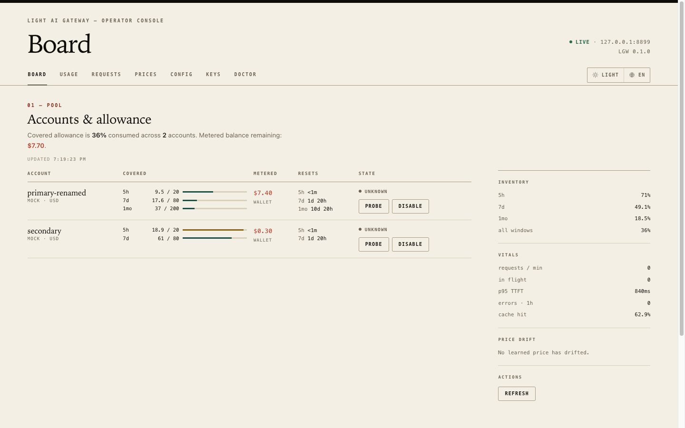

# light-ai-gateway

[English](README.md) | **简体中文**

一个很小的 OpenAI 兼容网关。它把同一家 provider 的多个账号汇成池子，配额窗口用尽时自动
绕开，省得你手工切 API key。

把任何 OpenAI 客户端指过来即可，模型名照旧。它替每个请求挑账号，窗口满了就切，并把每笔
花费都记下来。



*演示用控制台；实际监听端口以你的配置为准。*

**目录**

- [为什么用它](#为什么用它)
- [安装](#安装)
- [快速开始](#快速开始)
- [工作方式](#工作方式)
- [配置](#配置)
- [控制台与运维](#控制台与运维)
- [排障](#排障)
- [文档](#文档)
- [开发](#开发)
- [安全](#安全)
- [许可证](#许可证)

## 为什么用它

- **说 OpenAI Chat Completions。** 只有一个端点，继续用你现有的 SDK，不用改代码。
- **按 provider 汇账号池。** 同一家 provider、同一个模型，可以挂好几把 key；网关按请求
  挑一个。
- **在你察觉之前就换号。** 接近软阈值的账号不再接新会话；请求转给下一个账号，窗口重置后
  再回来。
- **绝不误烧 metered 的真钱。** 付费余额默认锁死，只有按 provider 显式开启才会动用。
- **看得到发生了什么。** 终端看板和浏览器控制台展示额度、重置倒计时、成本、token、缓存
  命中率和最近的尝试。
- **在浏览器里配置。** 控制台编辑同一份配置文件，发布改动时不打断在途请求。只绑
  loopback，没有登录。

## 安装

要求 Rust **1.88 或更新**。凭据库使用 macOS 钥匙串、Windows Credential Manager 或
freedesktop Secret Service；只有 macOS 需要下面那一步签名。

```
cargo install --path . --locked
lgw --version
```

它把 `lgw` 和 `lgwl` 的 release 二进制装进 `~/.cargo/bin`。

**macOS 上请改用这个包装脚本：**

```
scripts/lgw-identity.sh      # 一次：创建签名证书
scripts/lgw-install.sh       # cargo install，然后给两个二进制签名
```

普通的 `cargo install` 会用 ad-hoc 签名覆盖已签名的二进制，钥匙串又开始问你要密码。不
介意这些弹窗才跳过包装脚本。

拿到二进制的其它办法：`cargo build --release` 后复制 `target/release/lgw`，或者
`cargo install --git <repo-url> --locked`。用 `cargo uninstall light-ai-gateway` 可以把
两个二进制一起删掉。

拉到新代码后运行 `lgwl update`。它会停掉正在运行的网关、重装，并用原参数重启；
`--no-restart` 则保持停止。见[启动器契约](docs/launcher.zh-CN.md)。

## 快速开始

```
lgw init                                      # 写入 ~/.light-ai-gateway/config.toml
$EDITOR ~/.light-ai-gateway/config.toml        # 填 providers、accounts 和 routes
lgw keys add xkiro acc-1                      # 隐藏输入；每个账号一次
lgw keys add xkiro acc-2
lgw keys list                                 # 确认每份凭据都能解析

lgw doctor                                    # 配置、凭据、探测连通性
lgwl launch                                   # 后台启动代理 + 控制台
lgwl status                                   # 在跑吗？
lgwl log                                      # 跟随日志；Ctrl-C 只退出查看器
```

生成的配置本身就是一份能跑的例子。你必须改的部分长这样：

```
[providers.xkiro]
adapter = "xkiro"
base_url = "https://api.xkiro.com/v1"
currency = "USD"

[providers.xkiro.accounts.acc-1]

[routes]
"z-ai/glm-5.3-flash" = "xkiro"
```

没写 `key` 的账号会去系统凭据库里按 `<provider>/<account>` 读取。路由的 key 就是发往上游
的模型 id。

把客户端指过来：

```
export OPENAI_BASE_URL=http://127.0.0.1:8787/v1
export OPENAI_API_KEY=unused          # 或者你配的 local_key
```

```
curl http://127.0.0.1:8787/v1/chat/completions \
  -H 'Content-Type: application/json' \
  -H 'Authorization: Bearer unused' \
  -d '{"model":"z-ai/glm-5.3-flash","messages":[{"role":"user","content":"hello"}]}'
```

应该拿到一个正常的 Chat Completions 响应。同一个地址也提供控制台：打开
<http://127.0.0.1:8787/>。

想在终端里直接看日志时，仍然可以用 `lgw serve`。`lgwl exit` 停掉后台实例。

## 工作方式

**账号**是一份 provider 凭据，外加它自己的配额状态。配额以**窗口**的形式到达（比如 5 小时、
每周或每月），每个窗口有上限和重置时间。网关跟踪每个账号的窗口，并在每个请求上决定由哪个
账号来服务。

钱有两种，网关刻意把它们分开：

| 类别 | 例子 | 行为 |
|---|---|---|
| **Covered** | 订阅花费窗口、月度套餐额度 | 预付，窗口重置即作废。优先使用。 |
| **Metered** | 钱包余额、购买的 credits、API 余额 | 真钱，花掉就不再回来。运维没显式开启就拒绝。 |

开关是全局的 `[policy] allow_metered`；`[providers.<name>] allow_metered` 按 provider
覆盖它。

账号选择，一口气说完：

1. **硬闸门。** 只有 covered 余量能覆盖「估算成本 + 预留」的账号才是候选。
2. **粘性优先。** 会话当前的账号仍是候选时，就继续用它；搬一次会毁掉 provider 的提示缓存。
3. **先用尽优先。** 软阈值以下，用已用量最大的账号，让切换尽量少。
4. **软阈值是偏好，不是墙。** 所有账号都超过 80% 时，只要还有余量，用量最少的那个照常服务。

池子空了，网关就回答 429，附带一个真实的 Retry-After，取自最早的重置时间。它绝不悄悄跌到
另一家 provider，也不会花 metered 余额。完整规则（含失败处理）见
[路由](docs/routing.zh-CN.md)和[运维](docs/operations.zh-CN.md)。

## 配置

查找顺序：`--config PATH` → `$LGW_CONFIG` → `./lgw.toml` →
`~/.light-ai-gateway/config.toml`。`lgw doctor` 会打印它用的是哪一个。

```
~/.light-ai-gateway/config.toml       配置
~/.light-ai-gateway/gateway.db        用量账本（SQLite）
~/.light-ai-gateway/lgwl/             启动器 pid/日志状态
操作系统的凭据库                      provider API key
```

密钥默认绝不写进文件：`lgw keys add` 把它放进系统凭据库，配置按 provider/account 名字
引用它。监听器一旦能被 loopback 之外访问，就需要一把本地 token 保护；设 `server.local_key`
后要求客户端携带。详见[凭据](docs/credentials.zh-CN.md)。

控制台的表单把改动应用到运行中的进程，不打断在途请求。只在重启后生效的设置（`listen`、
`db_path`、`max_body_bytes`）会标成仅重启，而不是被默默忽略。控制台从不改写它不认识的
注释和键。访问与重载的完整契约见[控制台文档](docs/web-ui.zh-CN.md)。

## 控制台与运维

控制台由与代理相同的进程、相同的监听器提供：

- 看板：账号、covered 额度、metered 余额、重置倒计时、存货和价格漂移。
- 用量：按 provider/模型/账号的合计、每日图表、TTFT 和缓存命中率。
- 请求：最近的尝试、重试、筛选和覆盖情况。
- 价格、密钥、诊断和配置：CLI 的运维动作，外加配置表单。
- 只绑 loopback，没有登录、没有 cookie、没有会话。会改状态的请求还需要 JSON 请求体和
  同源头。

常用命令：

| 命令 | 作用 |
|---|---|
| `lgw serve` | 前台运行代理和控制台 |
| `lgwl launch` / `lgwl exit` | 后台运行 / 停止 |
| `lgw status` | 账号看板，带重置倒计时 |
| `lgw doctor` | 配置、凭据、探测连通性和常见配置错误 |
| `lgw keys add/list/remove/test` | 管理 provider 凭据 |
| `lgw accounts list/probe/disable/enable` | 查看并恢复账号 |
| `lgw usage --since 7d --group-by provider,model` | 用量报告 |
| `lgw prices [--drift-only]` | 配置价与学到的价 |
| `lgw tail` | 最近的请求 |

出问题时先跑 `lgw doctor`。启动器、日志和进程生命周期见
[docs/launcher.zh-CN.md](docs/launcher.zh-CN.md)；日常恢复和输出解读见
[docs/operations.zh-CN.md](docs/operations.zh-CN.md)。

## 排障

| 症状 | 先看哪里 |
|---|---|
| 每个请求都是 `no eligible account` | `lgw status`：账号可能被 park、被停用，或者卡在硬闸门下。429 的响应体会点名余量最大的账号。 |
| 修好 key 之后账号仍是 DISABLED | 探测只恢复还有余量的账号；运维手工停用需要 `lgw accounts enable`。 |
| 每次运行都弹密码框（macOS） | 授权绑在代码签名上，而 `cargo install` 生成的是 ad-hoc 签名；跑 `scripts/lgw-install.sh`。 |
| 价格看着不对 | `lgw prices --drift-only`。学到的价是观测值；配置价永远不会被它覆盖。 |
| 每个请求都是 429，Retry-After 很长 | 某个 covered 窗口用尽了；`lgw status` 会显示重置倒计时。 |

更多症状和修法：[运维](docs/operations.zh-CN.md)。

## 文档

- [控制台契约](docs/web-ui.zh-CN.md)
- [后台启动器](docs/launcher.zh-CN.md)
- [HTTP API](docs/api.zh-CN.md)
- [凭据与 macOS 钥匙串](docs/credentials.zh-CN.md)
- [价格、学到的价与漂移](docs/prices.zh-CN.md)
- [路由与两种配额](docs/routing.zh-CN.md)
- [运维与排障](docs/operations.zh-CN.md)
- [GET /v1/usage 契约](docs/usage-endpoint.zh-CN.md)
- [架构决策记录](docs/adr/)

## 开发

```
cargo test
cargo clippy --all-targets -- -D warnings
cargo fmt --check
```

仓库里没有 CI 流水线：这三条再加一次 release 构建，就是改动前的检查。单元测试放在它覆盖
的代码旁边；CLI 生命周期测试在 `tests/lgwl_cli.rs`。

各家 provider 的配额适配器在 `src/quota`。加一家 provider 就是实现一个 trait，再声明它
的 base URL、凭据和错误词表。`adapter = "none"` 不能接流量：账号只有配额探测成功后才会
进池子，所以请用 `xkiro`、`command-code`、`deepseek` 或 `haoai`。

## 安全

- 默认只绑 loopback。监听地址不是 loopback 就必须有本地 key；缺了配置会被直接拒绝，而
  不是只留一条警告。
- Provider 密钥存在操作系统的凭据库里，从不进日志，在所有调试和展示路径里都会被脱敏。
- 探测主机写死在配置里，重定向一律拒绝，所以请求无法把凭据重定向到别处。
- 配额探测失败时保留上一次读数并标记为 stale；绝不把读数清零。
- 不存储提示和响应正文。
- 控制台改动需要 JSON 和同源头，并会对照 `Host` 与 `Origin` 检查。
- 配置写入整体校验、原子替换；在控制台底下被改过的文件绝不会被覆盖。

## 许可证

MIT，见 [LICENSE](LICENSE)。随便用、随便改、随便发布、随便卖。不提供任何担保，而当你把
它配置成会花钱时，它确实会花真钱。
